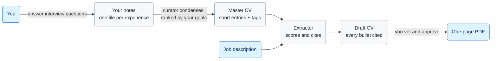

# cv-studio

A CV system that tailors your CV to each job description from your own experiences, with every bullet cited back to something you actually said.

I built this because I was tired of keeping one CV and rewriting it for every job. Each rewrite lost a fact or two, and when I started using AI to tailor it, the claims drifted further from the truth with every version. I wanted the opposite. My facts should live in one place, in my own words, and every tailored CV should be checkable against them line by line.

So here is how it works. You describe each experience once, in an interview with an AI that asks follow-up questions. Those notes become a master CV. When you find a job, you paste the job description. An agent picks your strongest material for that job description and cites the exact line in your notes behind every bullet. You check it, answer its questions, click Approve, and get a one-page PDF.


The screenshots show Robin Tay, a made-up student who comes with the repo so you can see the whole thing working before you add your own data.

## How it fits together



Everything is plain markdown in the repo. Each file has one agent that writes it, and the only other writer is you, through CV Studio, which shows you every change first. The agents are Claude Code subagents with narrow jobs. CV Studio is a small local web app that runs them for you. There is one human checkpoint, your Approve click, and nothing changes the content after it.

When you apply for a job, the extractor scores every entry in your master CV out of 10. It looks at how many of the job description's must-haves the entry shows, how close the work is to the role, what your goals say, and how recent it is, since recent work is easier to talk about in an interview. You see that breakdown for every pick, so nothing is chosen behind your back.

A few rules I cared about. Each one is written into the agent prompts and also checked by code:

- **No invented facts.** Every bullet cites `(source: experiences/<slug>/index.md L14)`. If the agent cannot point to a line, the bullet does not get written.
- **Only you approve.** No agent can set `status: approved`. The button stays disabled while any question is open.
- **Agents can only write their own files.** Each headless run is fenced to the exact files it owns, and code checks after the run that none of your notes went missing.
- **It runs on your Claude Code login.** No API key, nothing billed per token, and the server refuses to start if an API key is set.

The full design, with the reasoning behind each choice, is in [docs/ARCHITECTURE.md](docs/ARCHITECTURE.md).

## Quick start

You need macOS or Linux, Python 3.11 or newer, Google Chrome, and [Claude Code](https://docs.claude.com/en/docs/claude-code) installed and logged in.

```sh
git clone https://github.com/KSDNicholas/cv-studio.git
cd cv-studio
python3 -m venv .venv && .venv/bin/pip install playwright pypdf
.venv/bin/python tools/example.py load
.venv/bin/python tools/ui.py
```

CV Studio opens at http://127.0.0.1:8765 with Robin's data. Click around the four tabs. Open the BrightMart application to see why each entry was picked, the citations and the PDF.

When you are ready for your own CV:

```sh
.venv/bin/python tools/example.py fresh
```

That removes Robin and leaves blank files. Fill in `master/profile.md` and `master/goals.md`, then add your first experience. [docs/SETUP.md](docs/SETUP.md) has the details, including the macOS app and troubleshooting. [docs/USING.md](docs/USING.md) walks through the day to day.

## Your data stays yours

`master/`, `experiences/`, `applications/`, `seed/` and `tracker.md` are gitignored. You cannot push your CV to a public fork by accident. If you want your data under version control (I do, the diffs are useful), keep a private copy of the repo and remove those lines from `.gitignore` there. SETUP.md explains how.

## What's in the repo

| Path | What it is |
| --- | --- |
| `.claude/agents/` | The five agents: interviewer, curator, extractor, generator, goals-drafter |
| `.claude/skills/` | `/curate` and `/apply`, for running the same loops in a Claude Code chat |
| `CLAUDE.md` | The rules every agent follows: ownership, citations, CV style, tag vocabulary |
| `tools/ui.py`, `tools/ui/` | CV Studio, the local web app |
| `tools/render.py` | Markdown to one-page PDF, with Playwright and Chrome |
| `tools/*.py` | State, guards, undo, goals and tracker logic, with unit tests |
| `templates/cv.html` | The CV's look. Change it freely |
| `examples/robin/` | The example persona |
| `launcher/` | Builds a `CV Studio.app` for macOS |

## Status

I use this for my own applications. It is a personal project, so expect rough edges. The things I know about are listed at the end of [docs/ARCHITECTURE.md](docs/ARCHITECTURE.md).

## Licence

MIT. See [LICENSE](LICENSE).
