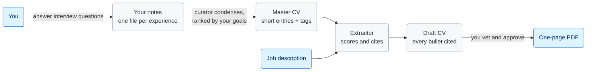
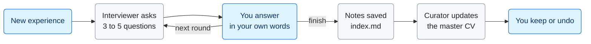
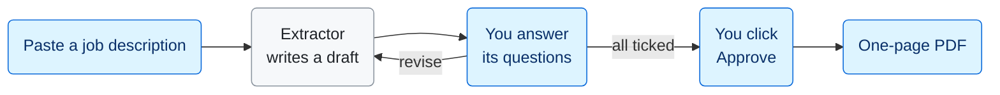
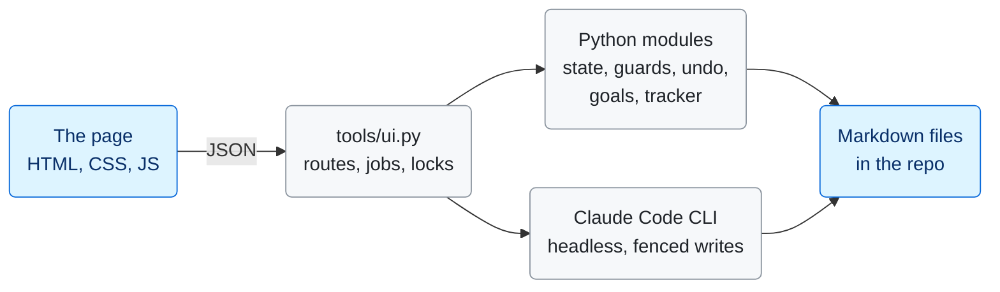

# How it works

This is the long version. It covers every part of the system and why I built it that way. If you only want to run it, read [SETUP.md](SETUP.md) and [USING.md](USING.md) instead.

## The idea

Most people keep one CV and edit it for every job. I was one of them. Facts get lost between versions, and every rewrite is a chance to inflate a claim a little. If you use an AI to tailor the CV, that drift gets faster.

So I flipped it. Facts live once, in long notes per experience, written from my own answers. A curated master CV condenses them. For each job, an agent proposes a tailored selection where every bullet cites the exact line it came from. I vet that, approve it, and a script renders the PDF. Nothing reaches a CV that I cannot trace back to something I said.



Blue boxes are you, what you bring and what you get back. Grey boxes are the files and agents in between.

There is exactly one human checkpoint: approval. Nothing changes content after it. The renderer may drop a bullet to fit one page, but it has to say which, and it can never add, reword or reorder anything.

## Four layers of truth

Every layer is a plain markdown file. I can read it, git can diff it, and agents can edit it with normal file tools. Each file has one agent that writes it. The only other writer is me, through CV Studio code that shows me the change first. That rule is what stops agents from quietly drifting my facts.

| Layer | File | What it holds | Written by |
| --- | --- | --- | --- |
| 1. Raw facts | `experiences/<slug>/index.md` | My answers, one fact per line, each tagged with who said it and when | The `/curate` skill or the interviewer agent |
| 2. Master CV | `master/master-cv.md` | Short entries: 2 to 4 bullets, tags from a fixed list, and a `retrieve:` pointer back to the notes | Curator only |
| 3. Per-job proposal | `applications/<slug>/extraction.md` | Chosen entries and bullets, a score per entry with its breakdown, every bullet cited as `(source: path L12)`, plus questions for me | Extractor, then me |
| 4. Output | `cv.html` and the PDF | The rendered page | `render.py` |

Three more files steer everything without holding CV content. `master/profile.md` is my name and contact details, the only place my identity lives. `master/goals.md` is my direction: target roles, what to lead with, what to demote. Only I change either of them. `tracker.md` is the one list of everything outstanding, and every step keeps it current.

### Why line citations

A citation like `index.md L14` takes two seconds to check. It turns "the AI wrote a bullet" into "the AI picked sentence 14 and tightened it". That is something I can defend in an interview.

The cost is that editing notes shifts line numbers. A draft made before an edit has to be re-extracted. A lot of the locking in CV Studio exists because of this.

## The agents

An agent here is a Claude Code subagent: a markdown file in `.claude/agents/` with a name, a tool list and instructions. They are stateless. Anything an agent needs must be in a file it reads or in its one task message. That is why every decision I make goes into a file and never stays in a chat.

| Agent | Job | Tools | May write |
| --- | --- | --- | --- |
| interviewer | One round of 3 to 5 tailored questions, then records my answers as notes | `Read, Edit, Glob, Grep` | one `index.md` and one `interview.md` |
| curator | Condenses notes into master CV entries, ranked by my goals, newer first on a tie | `Read, Write, Glob, Grep` | `master-cv.md`, the tag list in CLAUDE.md, status lines |
| extractor | Scores my entries against a job (tags, relevance, goals, recency), proposes the CV, asks me questions | `Read, Write, Glob, Grep` | its application folder |
| generator | Runs `render.py` from chat and checks the PDF | adds `Bash` | its application folder |
| goals-drafter | Rewrites goals.md from my note, as a proposal | `Read, Write` | only `tools/goals-draft/proposal.md` |
| manager (the `/apply` skill) | Routes an application by folder state | my chat session | `jd.md`, `answer:` lines |

The interviewer has no Write tool on purpose. Edit can only change part of a file, so it cannot replace my notes wholesale by accident.

Every agent ends with a fixed five-line message, like this one from the curator:

```
master-cv.md: 5 entries written/updated, 0 archived
quantify?: 0 bullets need numbers (none)
new tags: none
skipped: none
open: none
```

CV Studio splits each line at its first colon and acts on the labels. A `tracker:` line becomes a tracker row. A `new tags:` line becomes a banner where I can veto the tag. A free-form message would need another model to interpret it, and I wanted this part to be plain code.

## The loops

### Adding an experience

You can run this in chat with `/curate add`, or on the Experiences tab of CV Studio.



Behind each step, CV Studio's own code does the bookkeeping:

- **New experience** creates the folder and an `index.md` with `status: stub`.
- **Your answers** are copied into `interview.md` word for word before the interviewer sees them.
- **After every round** a guard compares the notes before and after. If a line of yours went missing, the run is undone.
- **Before the curator runs** the master CV is snapshotted. After it runs, code checks it only touched its own files, then shows you the diff for Keep or Undo.

### Applying for a job

The manager never guesses what to do next. It reads the folder and acts on its state. CV Studio's `appstate.folder_state()` mirrors the same table in code, so chat and app always agree.



The folder itself records where you are. It holds only `jd.md` until the extractor runs, then a draft `extraction.md`, then `status: approved` after your click, then the PDF. Rendering again moves the old PDF into `drafts/` first.

The extractor scores every master CV entry from 0 to 10 against the job (how that works is below), keeps the strongest, then reads only their notes to write cited bullets. Anything it is unsure about becomes an open question, like "The job description asks for Tableau. Your evidence is Power BI. Claim Tableau?" I answer in the page. My words are copied into the file as `answer:` lines and the extractor applies them in revise mode. Approve stays disabled until every question is ticked.

### How entries are picked

The score uses the master CV alone, so the extractor only opens the notes of entries it keeps. It has four parts:

| Part | Range | What it measures |
| --- | --- | --- |
| Tags and keywords | up to 6 | 2 per must-have the entry evidences, 1 per nice-to-have |
| Direct relevance | up to 3 | Same kind of work as the role, adjacent, or a transferable skill |
| Goals | +1 to -1 | Whether goals.md says to lead with it or demote it for this kind of role |
| Recency | +1 to -1 | +1 if it is ongoing or ended within 12 months of the job description's date, 0 for 12 to 36 months, -1 if older. Education gets 0 |

On equal scores the more recent entry goes first, and the curator uses the same tie-break when it orders the master CV.

I added recency because recent work is easier to talk about in an interview. I remember the numbers, the decisions and what went wrong. The bonus is small on purpose. It tips close calls toward recent work, but a weak recent project can't beat a strong older one.

Every selected entry carries its breakdown as a line in extraction.md, like `score: tags 6, relevance 3, goals +1, recency +1`. The renderer ignores that line. CV Studio shows it on the application's Overview, so I can see why each entry was picked and overrule it. Drafts made before the breakdown existed show a recency hint that `appstate.recency()` works out from the heading dates.

### Changing direction

I describe the change in my own words. The goals-drafter writes a proposal. I see a diff and choose Accept, Edit by hand, Revise or Discard. Only my Save click writes `goals.md`, with a backup first and a log entry after. A tracker row then marks the ranking as stale until I run Refresh ranking on the Master CV tab and keep the result.

## Inside CV Studio

CV Studio is a local web app with no framework and nothing to pay for. The server is Python's standard library `ThreadingHTTPServer` bound to `127.0.0.1:8765`. The page is one HTML file, one stylesheet and one plain JavaScript file. I kept it this small so there is nothing to install beyond Playwright and nothing to keep updated.

The sidebar has four tabs: Apps, Experiences, Master CV and Goals. The master CV and my goals are not experiences, so each gets its own tab instead of sitting at the top of the experience list. On the Master CV tab the sidebar lists the CV's sections with entry counts and jumps to each one. On Goals it mirrors the page's own tabs. An amber dot on a tab means something there needs me: a change to review, an agent working, or a ranking that is out of date.

Each experience in the list shows one label for where it stands with the CV (In CV, Planned, Archived, or its interview step) and an In Progress marker while its dates say it is ongoing. `expstate.timeline()` reads those dates, including academic years like AY24/25, and falls back to the master CV heading when the notes still say TODO. Status, Type, Year and Sort menus narrow the list, and Needs you at the top is the quickest way to see what I still owe the system. An experience merged into another entry sits indented under it.



The Python modules are `appstate.py` (application states, answers, Approve, entry scores and recency), `expstate.py` (experiences, interview records, guards), `undo.py` (snapshots, Keep and Undo), `goalsfile.py` (goals drafts, backups, save) and `trackerfile.py` (tracker rows). A watchdog stops any agent run after 15 minutes.

I split the work in two. The server does everything boring and deterministic: creating folders, writing answer lines, flipping status lines, moving files, editing the tracker. That code is tested and never calls a model. Agents only get the judgement calls: questions, condensing, selecting and drafting. Each run is a fresh session with no memory.

All state lives in the files. The server can restart without losing anything. A job cut off by a restart shows "This run was interrupted" with a Retry button.

### Jobs and locks

Every agent run or render is a job on its own thread, keyed by what it touches: an application slug, `exp:<slug>`, `master` or `goals`. Kinds fall into groups.

| Group | Kinds | Why |
| --- | --- | --- |
| Readers | `extract`, `revise` | Read notes and cite their line numbers |
| Writers | `ask`, `next`, `finish`, `curate`, `refresh` | Change notes or the master CV, which shifts those line numbers |
| Neither | `goals`, `preview`, `render` | The drafter writes only a gitignored proposal. Renders read one approved file |

The rule is a plain readers and writers lock. A writer waits for any reader or writer. A reader waits for any writer. Without it, an interview could add a line to my notes while the extractor was citing them, and every citation below that line would point one line off.

### Keep or Undo

Before any curator run, `undo.take()` copies the master CV, CLAUDE.md, tracker.md and the notes in scope into gitignored `tools/undo/`. After the run, `seal()` hashes how the run left them. The page shows a word-level diff and I click Keep or Undo.

Undo restores a file only if nobody changed it since the run. For notes it restores only the status line, so my own words always stay. A run that changes only bookkeeping, like a status line or a tracker row, is kept automatically because there is nothing to review.

## Running Claude headless

CV Studio never calls an API with a key. It runs the Claude Code CLI you already use, on your own subscription login, as a child process:

```sh
claude -p "Application folder: applications/2026-10-brightmart-data-analyst/\nmode: revise" \
  --agent extractor \
  --permission-mode dontAsk --permission-prompts none \
  --allowedTools "Read,Glob,Grep,Edit(//<repo>/applications/2026-10-brightmart-data-analyst/**)" \
  --disallowedTools "Bash,WebFetch,WebSearch,Agent" \
  --output-format stream-json --verbose --effort high
```

- `-p` runs one prompt and exits. `--agent` makes the named subagent the main agent of that session.
- `dontAsk` denies anything not explicitly allowed instead of prompting. A headless run has nobody to answer a prompt.
- The write fences are `Edit(//absolute/path)` allow rules. Edit rules cover the Write tool too, so an agent can only write the exact files or folder it owns.
- `stream-json` prints one JSON event per line. The server reads each tool call as it happens. That drives the live status line ("Reading experiences/budget-buddy/index.md") and the progress steps. The last event carries the final message, the turn count and any permission denials. Any denial fails the run.
- The child's environment drops `ANTHROPIC_*` and `CLAUDE_CODE_*` variables, and the server refuses to start if an API key is set. A run can never bill the API by accident.

### The read fence lesson

I got this wrong at first. Allow rules fence writes but not reads. Claude Code lets an agent read any file by default, so my `Read(path)` allow rules restricted nothing.

That mattered for the goals-drafter. It must only see goals.md and my note, or it could pull a company name out of my notes and add it to my goals. So it runs a different way. CV Studio makes a temp folder outside the home directory holding copies of only CLAUDE.md, goals.md and the agent file, runs the drafter there, and adds `Read(/<home>/**)` as a deny rule. Deny always beats allow. I checked it with a probe run: the drafter could not open the master CV.

### Timeouts that survive sleep

Python's `threading.Timer` waits on the monotonic clock, and that clock stops while a Mac sleeps. One curator run once "took" ten hours because of it. The watchdog now checks `time.time()` every few seconds and stops a run after 15 minutes of wall clock time, sleep included.

## Rules enforced by code

Instructions to an agent are a request. A check in code after the run is a guarantee. Where it mattered, each rule has both.

| Rule | Where code enforces it |
| --- | --- |
| Only I approve a CV | Approve is a server route that flips `status: approved` only after confirming zero open questions. No agent can set it. |
| Only I change goals.md | The drafter's only write fence is a gitignored proposal. `goalsfile.save()` runs only behind my Save click, rechecks the file under a lock, backs up first and logs after. |
| The interviewer never loses my notes | `index_guard()` compares notes before and after. A missing line outside Open questions, or a changed status line, restores the snapshot and fails the run. |
| The curator touches only its files | After the run, the index.md diff must be status-only, and CLAUDE.md may change only inside its Tag vocabulary section. Otherwise everything is restored. |
| No em dashes, en dashes or semicolons on a CV | `render.py` refuses to render a page that contains one. It also refuses colons inside bullets, except the "Relevant coursework:" label. |
| Nothing invented in goals | `new_terms()` lists names and numbers in a proposal that are in neither the old file nor my note, and the page shows them in a warning banner. |
| No stale vetting | Every write carries the file's modified time from when the page loaded it. If the file changed underneath (an edit in an editor or in chat), the server answers 409 and the page asks me to reload. |

## From markdown to a one-page PDF

1. `render.py` parses the approved extraction.md into entries, bullets, education and skills, and reads the header from `master/profile.md`.
2. It checks style rule 4 mechanically and refuses, with a list of problems, if anything breaks it.
3. It fills `templates/cv.html`, a single HTML and CSS file with `{{placeholders}}` and an A4 `@page` rule.
4. Playwright drives your installed Chrome headless and prints the page to PDF.
5. `pypdf` counts the pages. If the CV runs over, the last bullet of the lowest-scored entry is dropped and the page renders again. That happens at most three times, and every drop is reported.

Previews go to `*_PREVIEW.pdf` files, and the page re-renders a preview by itself whenever the draft is newer than the PDF.

## The page

- No `innerHTML` for data. Every element is built with a small `el()` helper using `textContent`, so text from files can never inject markup. Even the markdown renderer builds DOM nodes.
- Polling, not websockets. While a job runs, the page asks `/api/jobs/<id>?since=n` once a second for new log lines. It is simple and it survives a server restart.
- Request guard. Every POST must come from the page itself: the Host and Origin must be `127.0.0.1:8765` and the request must carry an `X-CV-UI: 1` header. That stops another website from driving your local server.
- Drafts in the browser. Answers and goals edits autosave to localStorage, so a reload loses nothing.
- Done signals. On macOS a notification with a sound, plus the tab title counting up and a dot on the icon.
- Themes. Every colour is a CSS variable with a light and a dark value. It follows the system setting unless you pick one.

## Testing

The deterministic parts (state, parsing, guards, backups, the tracker, the recency rule, the renderer's style check) have unit tests in `tools/test_*.py`. They read the example persona in `examples/robin/`, never your own data, so they pass on any clone.

The agent parts I tested end to end on throwaway data in the real app, checked that restores were byte for byte, and reverted everything with git afterwards. The example persona's master CV and extraction were made the same way: I wrote Robin's notes by hand, then the real curator and extractor produced the rest.

## What I would change

- A failed run (as opposed to one I stop) does not roll back partial edits yet.
- The curator can add near-duplicate tracker rows.
- It depends on Claude Code, and the app launcher and notifications are macOS only. The server itself runs anywhere Python and Chrome do.
