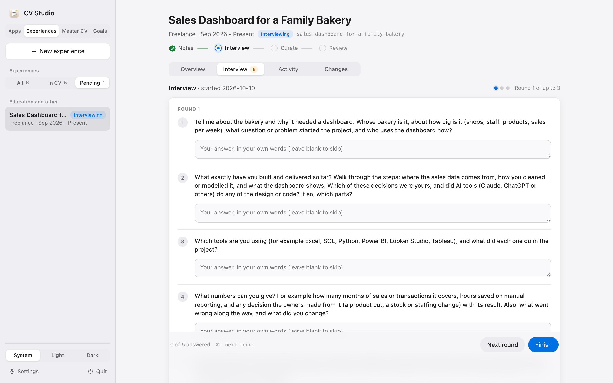
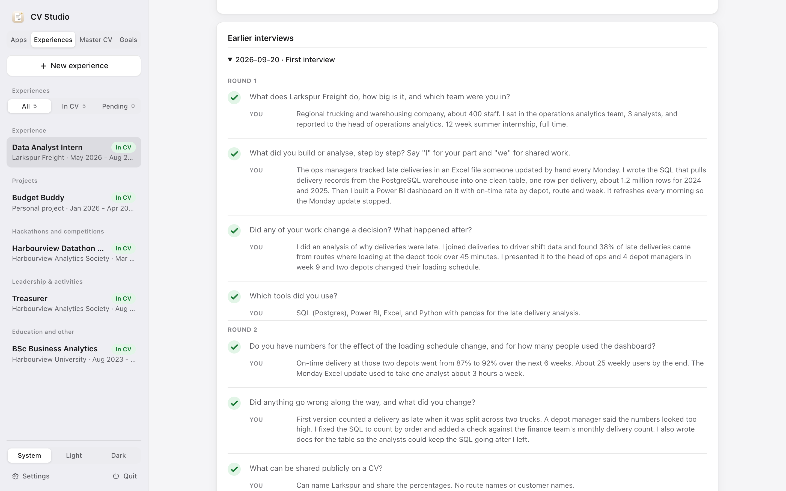
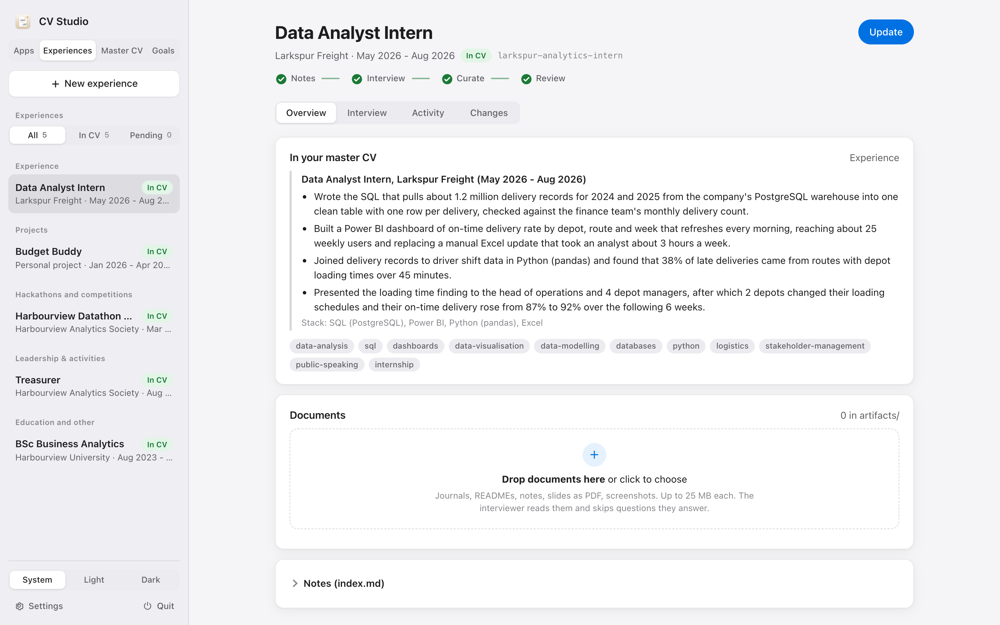
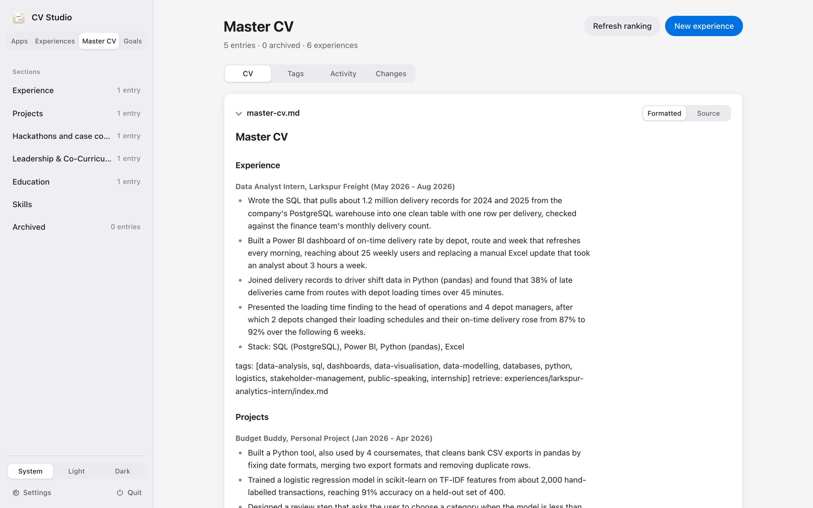
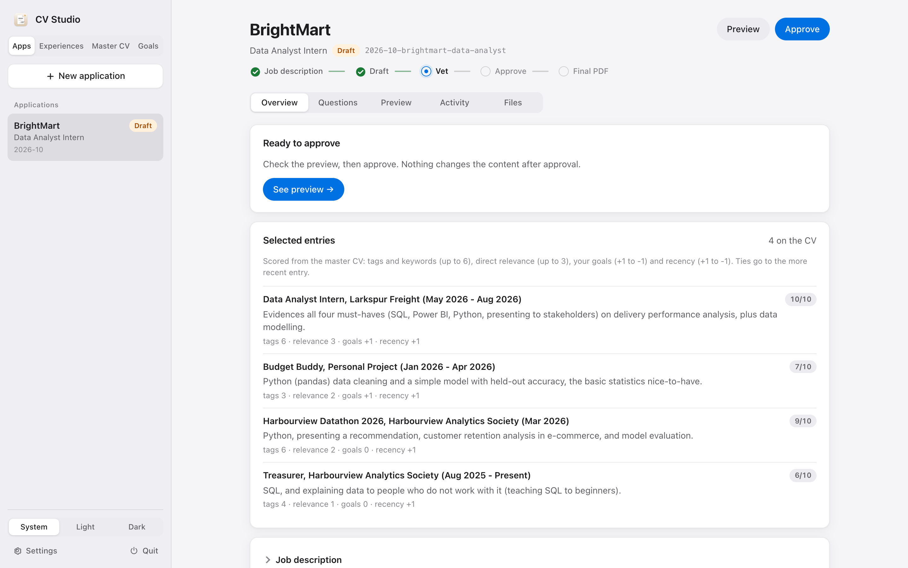
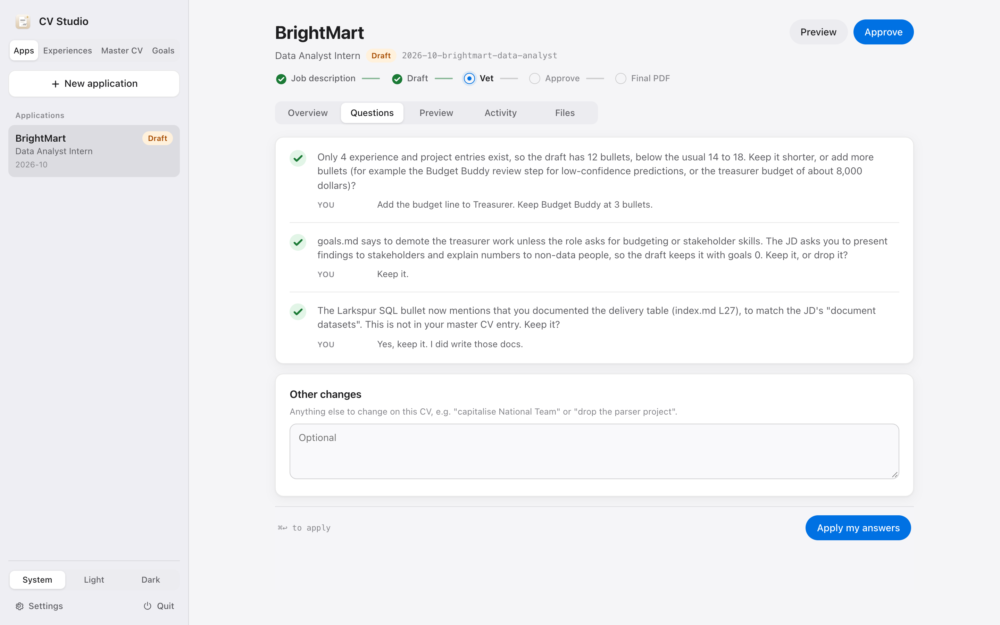
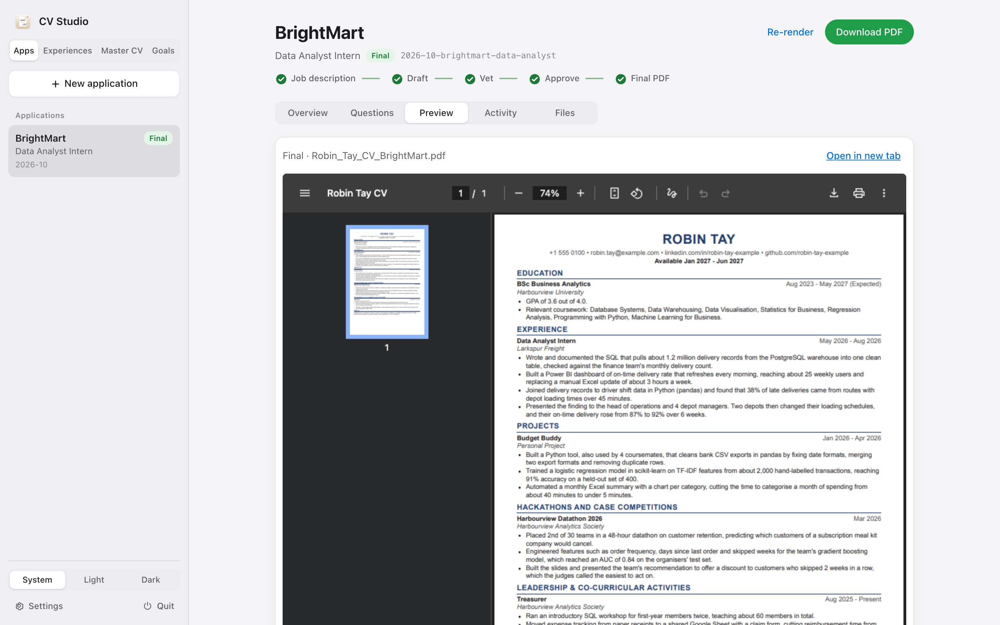
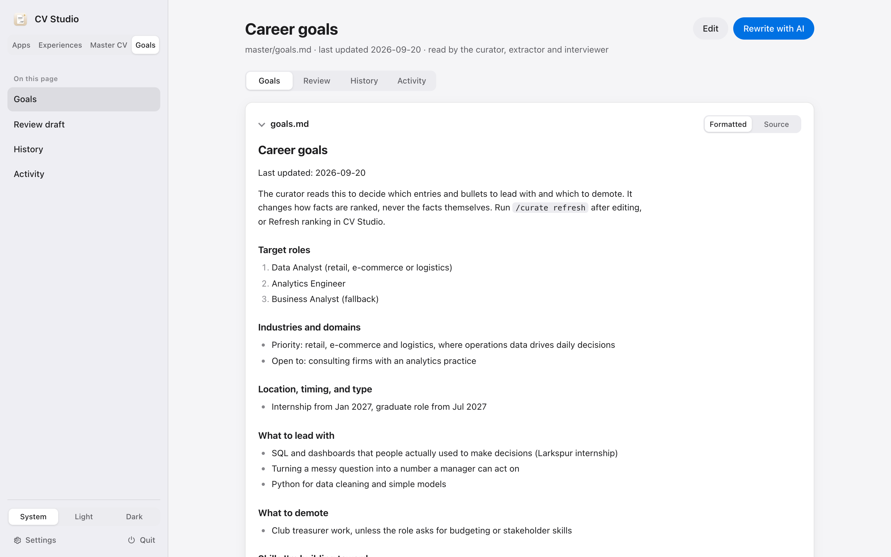

# Using it

This is the day to day: adding experiences, applying for a job, and changing direction. The screenshots show Robin Tay, the example persona. If you haven't set up yet, start with [SETUP.md](SETUP.md).

There are two ways to do everything here. CV Studio is the web app, and it is what I use most. The other way is a Claude Code chat in the repo folder, with the `/curate` and `/apply` skills. Both read and write the same files, so you can switch whenever you like. Just don't run both on the same experience or application at the same time.

CV Studio has four tabs along the top of the sidebar:

- **Apps**: your job applications, from pasted job description to final PDF.
- **Experiences**: everything that could go on a CV, with a filter for what's done and what's still in progress.
- **Master CV**: the condensed menu every application picks from.
- **Goals**: where you're heading, which decides what gets ranked first.

An amber dot on a tab means something there needs you.

## 1. Add an experience

An experience is anything that could become a CV entry: a job, an internship, a project, a hackathon, a club role, your degree.

In CV Studio, open the **Experiences** tab and click **New experience**. Give it a title, an organisation, dates and a type. That creates `experiences/<slug>/index.md` with empty sections.

Then the interviewer asks you 3 to 5 questions at a time. Answer in your own words, as if you were telling a friend. Rough is fine. Say "I" for what you did and "we" for what the team did, because the agents keep that distinction all the way to the CV. After each round you can click **Next round** for follow-ups or **Finish**.

The filter above the list has three settings. **In CV** shows experiences already condensed into your master CV. **Pending** shows everything where the loop isn't closed yet: new, being interviewed, or waiting for the curator. **All** shows both, plus anything archived. I check Pending every week or so. It's the list of things I started telling the system about and never finished.

Once a round is answered, it stays in the record:

Your answers are copied into `interview.md` word for word. The interviewer turns them into notes in `index.md`, one fact per line, each tagged with your short name and the date. Code checks after every round that none of your earlier notes went missing.

If you have documents (a project README, slides, a journal), drop them into the experience's Documents box. The interviewer reads them and skips questions they already answer.

When you click **Finish**, the curator condenses the notes into a master CV entry. You see a word-by-word diff of what changed and choose **Keep** or **Undo**.

When something changes later, like a result comes in or you finish a project, open the experience and click **Update**. You describe what changed and get a short interview about just that.

In chat, the same loop is `/curate add`, `/curate update <slug>`, or `/curate backfill` to start from an old CV in `seed/`.

## 2. Look at your master CV

The **Master CV** tab shows every entry, grouped by section and ranked by your goals. It is the menu the extractor picks from for each job. The sidebar lists the sections with how many entries each holds. Click one to jump to it.

You never edit this file by hand. Only the curator writes it, from your notes. If a bullet is wrong, the fix belongs in the notes: open the experience, click Update and say what is wrong. That keeps the rule that every line on a CV traces to something you said.

## 3. Apply for a job

Click **New application**, paste the job description, and give the company and role. CV Studio creates `applications/<yyyy-mm>-<company>-<role>/` and starts the extractor. It takes two or three minutes.

The extractor scores each master CV entry against the job, keeps the strongest, reads only their notes, and writes `extraction.md`. Every bullet ends with a citation like `(source: experiences/larkspur-analytics-intern/index.md L21, L41)`.

The **Overview** tab shows which entries were picked and why. Each one has a score out of 10 and its four parts:

- **tags**: how many of the job description's must-haves and nice-to-haves the entry shows (up to 6)
- **relevance**: how close the work is to the role (up to 3)
- **goals**: +1 if your goals say to lead with it, -1 if they say to demote it
- **recency**: +1 if it's ongoing or ended in the last 12 months, 0 for 12 to 36 months, -1 if older

Recency is there because recent work is easier to talk about in an interview. It's a small nudge, so it mostly decides close calls. When two entries tie, the newer one goes first.

If a pick looks wrong, say so in your answers ("drop the treasurer role") and the extractor will change it.

Then come the questions. These are the things the extractor would not decide on its own: a must-have skill with thin evidence, a number it found only in a document, an entry your goals say to demote, a conflict between two notes.

Type your answers and click **Apply my answers**. Your words go into the file as `answer:` lines and the extractor revises the draft. Anything else you want changed goes in the free text box at the bottom.

Check the **Preview** tab. It shows the real PDF and re-renders by itself whenever the draft changes.

When every question is ticked and the page looks right, click **Approve**. That flips `status: approved`, and nothing about the content changes after this point. Then click **Render final CV** to get `<Your_Name>_CV_<Company>.pdf`. If it runs over one page, the renderer drops the weakest bullet from the bottom and tells you which one.

In chat, the same loop is `/apply` followed by the pasted job description. You answer the questions in chat, set `status: approved` in the file yourself, then run `/apply --approved`.

### When to re-extract

Citations point at line numbers. If you update an experience after a draft was made, the lines shift and the citations go stale. Run `/apply --redo <slug>` (or start a new application) for any draft that cites that experience. Finished PDFs are not affected.

## 4. Change direction

Your target roles will change. When they do, open the **Goals** tab.

You can click **Edit** and change the file yourself. Or click **Rewrite with AI**, describe the change in a sentence or two, and the goals-drafter proposes a new version. You see the diff and choose **Accept**, edit it further, ask for a revision, or **Discard**. If the proposal mentions a company, role or date that is not in your old file or your note, a warning names it so you can catch anything invented.

Only your **Save** click writes `goals.md`. A backup is taken first and the change is logged in `master/goals-log.md`.

Saving adds a tracker row saying the ranking is stale. Click **Refresh ranking** on the Master CV tab to let the curator re-order your entries for the new direction, then Keep or Undo as usual.

## 5. The tracker

`tracker.md` is the list of everything outstanding: questions you haven't answered, things to revisit after a date ("add the result after the final"), applications in flight, and skills that job descriptions keep asking for that your notes don't show yet. Agents add rows as they work and delete them when they are resolved. Read it every so often. It is the to-do list for your CV.

## Making it yours

- **The look.** `templates/cv.html` is one HTML file with inline CSS and an A4 page rule. Change fonts, spacing and colours there.
- **The style rules.** The "CV writing style" section in `CLAUDE.md` is how I like CVs written: full sentences, no dashes or semicolons, nothing planned or in progress. If you prefer something else, edit those rules. If you change rule 4, update `style_problems()` in `tools/render.py` too, since it enforces that rule.
- **Tags.** The tag vocabulary in `CLAUDE.md` is what the extractor matches job descriptions against. Agents may add tags, and they tell you when they do, so you can veto them.
- **Effort.** Agents run at `high` effort by default. `tools/ui.py --effort medium` is faster and uses less of your plan.
